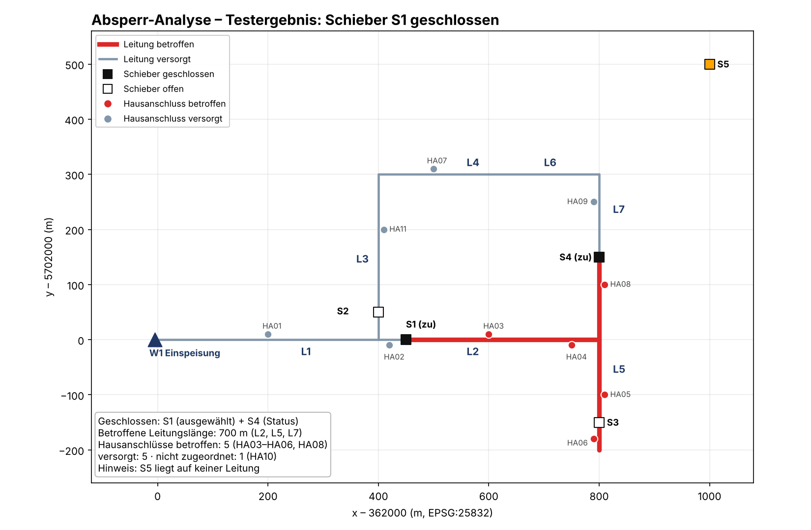

# QGIS Absperr-Analyse – Shut-off Analysis for Utility Networks

[English](#english) | [Deutsch](#deutsch)

<a id="english"></a>
A QGIS plugin that shows which **pipe/cable sections and house connections or buildings are cut off** when one or more valves or switches are closed. It traces the network from the supply points (e.g. waterworks, substation) with a breadth-first search written in pure Python – no networkx or other extra libraries are needed, so it runs in every QGIS installation. Valves that are normally closed (e.g. ring separation points) are read from a status field and taken into account.



---

## Functions

| Function | Description |
|---|---|
| Network building | Line end points are snapped into nodes (tolerance in m); multi-part lines are supported |
| Valves / switches | Each valve is projected onto the nearest line and splits it; an open valve connects both sides, a closed one separates them |
| Closed valves | Selected features in the valve layer **and/or** a status field (values such as `geschlossen`, `zu`, `closed`) |
| Network tracing | Breadth-first search from all supply points; every section that is not reached is **affected** |
| House connections / buildings | Point or polygon layer; each object is assigned to the nearest line (max. distance) and takes over the status of its section |
| Notes | Valves not on any line, supply points not on any line, connections without a line |
| Result layers | Memory layers *Shut-off – lines / connections / valves* with categorized styling (affected = red) |
| Result table | Summary, list of affected objects; double-click zooms to the feature |
| Export | GeoPackage, Excel (XLSX) or CSV via `QgsVectorFileWriter.writeAsVectorFormatV3` |
| Language | German or English, depending on the QGIS locale |

## Test result

Test data: `testdata/absperr_testdaten.gpkg` (EPSG:25832, fictitious network in Essen, no real data) with the layers `leitungen` (7 lines, 2,000 m), `schieber` (5 valves, S4 = ring separation point with status `geschlossen`, S5 deliberately not on a line), `einspeisung` (waterworks W1) and `hausanschluesse` (11 house connections, HA10 deliberately too far away).
Parameters: tolerance 0.5 m, valve → line 1 m, source → line 10 m, connection → line 30 m, status field `status`.

| Scenario | Closed valves | Affected length | Affected lines | Affected connections | Supplied | Not assigned |
|---|---|---|---|---|---|---|
| 1 – select **S1** | S1, S4 | **700.00 m** | L2 (350 m), L5 (200 m), L7 (150 m) | **5** – HA03, HA04, HA05, HA06, HA08 | 5 | 1 (HA10) |
| 2 – select **S2** | S2, S4 | **800.00 m** | L3 (250 m), L4 (200 m), L6 (200 m), L7 (150 m) | **3** – HA07, HA09, HA11 | 7 | 1 (HA10) |
| 3 – select **S2**, no status field | S2 | **0.00 m** | – (ring supplies from the east) | **0** | 10 | 1 (HA10) |

In all scenarios the note *"Valve S5 is not on any line"* appears. The core logic (`core.py`) was tested with these data in pure Python; all `.py` files were checked with `py_compile`.

## Installation

1. Download `absperr_analyse.zip` (or zip the folder `absperr_analyse/`).
2. QGIS → *Plugins → Manage and Install Plugins → Install from ZIP*.
3. Start via *Vector → Shut-off Analysis* or the toolbar button.

## Repository structure

```
QGIS-Shutoff-Analysis/
├── absperr_analyse/
│   ├── __init__.py          # classFactory
│   ├── absperr_analyse.py   # main class: menu, toolbar, result layers, table, export
│   ├── core.py              # network tracing in pure Python (testable without QGIS)
│   ├── dialog.py            # input and result dialogs (no .ui file)
│   ├── i18n.py              # German/English texts
│   ├── metadata.txt
│   ├── icon.png
│   └── LICENSE
├── testdata/
│   └── absperr_testdaten.gpkg
├── images/
│   └── 00_testergebnis_vorschau.png
├── README.md
└── LICENSE
```

## Tools

QGIS 3.28 – 4.x · PyQGIS · Python 3 (breadth-first search with `collections.deque`) · Qt (PyQt5/PyQt6) · GeoPackage · Matplotlib (preview)

## License

MIT – see [LICENSE](LICENSE).

---
---
<a id="deutsch"></a>
# Deutsch

Ein QGIS-Plugin, das zeigt, welche **Leitungsabschnitte und Hausanschlüsse bzw. Gebäude abgetrennt werden**, wenn ein oder mehrere Schieber oder Schalter geschlossen werden. Das Netz wird von den Einspeisungen (z. B. Wasserwerk, Umspannwerk) aus mit einer Breitensuche in reinem Python verfolgt – ohne networkx oder andere zusätzliche Bibliotheken, daher läuft es in jeder QGIS-Installation. Schieber, die im Normalbetrieb geschlossen sind (z. B. Ring-Trennstellen), werden aus einem Statusfeld gelesen und berücksichtigt.


---

## Funktionen

| Funktion | Beschreibung |
|---|---|
| Netzaufbau | Leitungsendpunkte werden zu Knoten gefangen (Toleranz in m); Multi-Linien werden unterstützt |
| Schieber / Schalter | Jeder Schieber wird auf die nächste Leitung projiziert und teilt sie; ein offener Schieber verbindet beide Seiten, ein geschlossener trennt sie |
| Geschlossene Schieber | Ausgewählte Objekte im Schieberlayer **und/oder** ein Statusfeld (Werte wie `geschlossen`, `zu`, `closed`) |
| Netzverfolgung | Breitensuche von allen Einspeisungen; jedes nicht erreichte Teilstück ist **betroffen** |
| Hausanschlüsse / Gebäude | Punkt- oder Polygonlayer; jedes Objekt wird der nächsten Leitung zugeordnet (max. Abstand) und übernimmt den Status seines Teilstücks |
| Hinweise | Schieber ohne Leitung, Einspeisungen ohne Leitung, Anschlüsse ohne Leitung |
| Ergebnislayer | Memory-Layer *Absperrung – Leitungen / Anschlüsse / Schieber* mit kategorisierter Darstellung (betroffen = rot) |
| Ergebnistabelle | Zusammenfassung, Liste der betroffenen Objekte; Doppelklick zoomt zum Objekt |
| Export | GeoPackage, Excel (XLSX) oder CSV über `QgsVectorFileWriter.writeAsVectorFormatV3` |
| Sprache | Deutsch oder Englisch, je nach QGIS-Sprache |

## Testergebnis

Testdaten: `testdata/absperr_testdaten.gpkg` (EPSG:25832, fiktives Netz in Essen, keine echten Daten) mit den Layern `leitungen` (7 Leitungen, 2.000 m), `schieber` (5 Schieber, S4 = Ring-Trennstelle mit Status `geschlossen`, S5 absichtlich nicht auf einer Leitung), `einspeisung` (Wasserwerk W1) und `hausanschluesse` (11 Hausanschlüsse, HA10 absichtlich zu weit entfernt).
Parameter: Toleranz 0,5 m, Schieber → Leitung 1 m, Einspeisung → Leitung 10 m, Anschluss → Leitung 30 m, Statusfeld `status`.

| Szenario | Geschlossene Schieber | Betroffene Länge | Betroffene Leitungen | Betroffene Anschlüsse | Versorgt | Nicht zugeordnet |
|---|---|---|---|---|---|---|
| 1 – **S1** auswählen | S1, S4 | **700,00 m** | L2 (350 m), L5 (200 m), L7 (150 m) | **5** – HA03, HA04, HA05, HA06, HA08 | 5 | 1 (HA10) |
| 2 – **S2** auswählen | S2, S4 | **800,00 m** | L3 (250 m), L4 (200 m), L6 (200 m), L7 (150 m) | **3** – HA07, HA09, HA11 | 7 | 1 (HA10) |
| 3 – **S2** auswählen, ohne Statusfeld | S2 | **0,00 m** | – (Ring versorgt von Osten) | **0** | 10 | 1 (HA10) |

In allen Szenarien erscheint der Hinweis *„Schieber S5 liegt auf keiner Leitung.“* Die Kernlogik (`core.py`) wurde mit diesen Daten in reinem Python getestet; alle `.py`-Dateien wurden mit `py_compile` geprüft.

## Installation

1. `absperr_analyse.zip` herunterladen (oder den Ordner `absperr_analyse/` zippen).
2. QGIS → *Erweiterungen → Erweiterungen verwalten und installieren → Aus ZIP installieren*.
3. Start über *Vektor → Absperr-Analyse* oder den Knopf in der Werkzeugleiste.

## Repository-Struktur

```
QGIS-Shutoff-Analysis/
├── absperr_analyse/
│   ├── __init__.py          # classFactory
│   ├── absperr_analyse.py   # Hauptklasse: Menü, Werkzeugleiste, Ergebnislayer, Tabelle, Export
│   ├── core.py              # Netzverfolgung in reinem Python (ohne QGIS testbar)
│   ├── dialog.py            # Eingabe- und Ergebnisdialog (ohne .ui-Datei)
│   ├── i18n.py              # Texte Deutsch/Englisch
│   ├── metadata.txt
│   ├── icon.png
│   └── LICENSE
├── testdata/
│   └── absperr_testdaten.gpkg
├── images/
│   └── 00_testergebnis_vorschau.png
├── README.md
└── LICENSE
```

## Werkzeuge

QGIS 3.28 – 4.x · PyQGIS · Python 3 (Breitensuche mit `collections.deque`) · Qt (PyQt5/PyQt6) · GeoPackage · Matplotlib (Vorschau)

## Lizenz

MIT – siehe [LICENSE](LICENSE).
